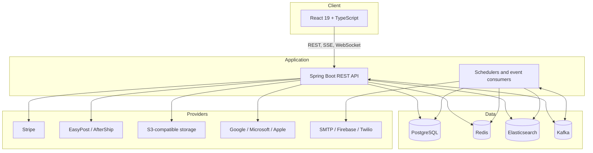

# Architecture

ShopWave is a modular monolith with a separate browser application. Business domains share one Spring Boot process and PostgreSQL schema, while Redis, Elasticsearch, and Kafka provide specialized infrastructure.

## System View

## Frontend

The frontend is a Next.js App Router application ([ADR 0001](decisions/0001-nextjs-app-router.md)). Routes live under `frontend/src/app` in four route groups that do not appear in URLs: `(storefront)`, `(auth)`, `(account)`, and `(merchant)`. The [frontend route map](frontend-route-map.md) lists every URL and its segment. Each `page.tsx` is a thin server component that sets metadata and renders a client view from `frontend/src/views`. Views compose domain components, call the modules under `frontend/src/api`, validate forms with Zod and React Hook Form, and use TanStack Query for server state. Redux slices hold cross-cutting client state such as authentication, cart, marketplace, vendor, and loyalty context.

The root layout (`src/app/layout.tsx`) renders the Navbar, Footer, and feedback button inside the client providers (`src/app/providers.tsx`):

- `StoreProvider` creates one Redux store per browser session with `makeStore()` and seeds the configured default marketplace. It also binds the store to `src/api/authBridge.ts`, which is how the axios client and session refresh read the access token without a module-level store.
- `QueryClientProvider` uses `getQueryClient()`: a fresh client per server render and one long-lived client in the browser. Logout clears it.
- `AuthInitializer` restores the session once per page load through `refreshSession()` (`src/api/session.ts`). Refresh tokens are single-use, so every caller, including the 401 retry interceptor, shares one in-flight refresh request. It does not block rendering: pages render immediately (on the server and in the browser), and `auth.sessionRestored` becomes `true` once the refresh and company lookup have settled.
- The `(account)` and `(merchant)` layouts wrap their pages in `RequireAuth` and set `noindex`. The guard renders a spinner until `auth.sessionRestored` is `true` (always the case in server HTML, so protected shells never contain private data), then redirects visitors without an access token to `/login?next=<path and query>`. The backend authorizes every API call; the frontend role and capability checks only hide navigation. See [frontend session boundary](#frontend-session-boundary).

Unknown URLs render `src/app/not-found.tsx` with HTTP `404`.

### Server Rendering and Caching

Public storefront pages render their content on the server, so the HTML is useful before (and without) JavaScript:

| Route | Rendering | Server-prefetched data |
| --- | --- | --- |
| `/` | ISR, 60 s | Featured collections |
| `/browse` | Per request (query-driven) | Catalog search results for the URL filters |
| `/products/[id]` | ISR on demand, 60 s | Product; also emits `Product` JSON-LD |
| `/c/[id]` | Per request (query-driven) | Public company profile, first catalog page, first announcements page |
| `/collections/[slug]` | ISR on demand, 60 s | Collection, members, and member products |
| `/kits/[companyId]/[kitId]` | ISR on demand, 60 s | Kit |
| `/lists/public/[slug]` | ISR on demand, 60 s (`noindex`) | Shared list |

How it fits together:

- **Server reads** go through `src/api/server/`. `serverGet()` calls `API_INTERNAL_URL` directly with `fetch` and the Next.js data cache (`revalidate: 60`). It never forwards cookies or `Authorization`, so server HTML and cached responses can only contain public data. Per-user data, such as follow status, price watches, back-in-stock subscriptions, and loyalty balances, loads in the browser after hydration.
- **Hydration.** Each page seeds its data into TanStack Query with `Hydrate` (`src/api/server/hydrate.tsx`) under the same keys the client view queries. The keys live in `src/api/keys.ts`; URL filters are parsed by `src/lib/catalogParams.ts` on both sides. The view renders that data immediately and refetches it in the background once it is stale.
- **Failures.** A missing or malformed entity (backend `404` or `400`) renders `src/app/(storefront)/not-found.tsx` with HTTP `404`. Any other backend failure renders the page without prefetched data, and the view retries in the browser.
- **No streaming fallbacks.** These routes deliberately have no `loading.tsx`, so the response waits for the data. That keeps the content in the initial HTML and keeps the `404` status code.
- **Metadata.** `generateMetadata` sets the title, description, canonical URL, and Open Graph tags from the same cached reads. Helpers live in `src/lib/seo.ts`. `/browse` and `/c/[id]` are `noindex` when free-text or price filters are present. `robots.txt` (`src/app/robots.ts`) disallows account, merchant, and auth prefixes.
- **Motion.** Server-rendered content must stay visible without JavaScript. `useAnims` returns visible "hidden" variants until the first hydration completes (`src/hooks/useHydrated.ts`), so only content mounted afterwards plays entrance animations.
- **Deterministic text.** Text rendered on the server must not depend on the server's locale, time zone, or clock. Use `src/lib/format.ts` (fixed `en-US` locale, UTC calendar dates), and render clock-dependent labels only after hydration (`useIsClient`).
- **Marketplace.** Catalog pages read `DEFAULT_MARKETPLACE_ID` on the server. Pages prerendered at build time also read it during the build.

The browser always calls same-origin `/api/*`. A rewrite in `frontend/next.config.ts` forwards those requests to `API_INTERNAL_URL` (default `http://localhost:8090`). This keeps the host-only refresh cookie working and avoids CORS. `npm run dev` serves the frontend on port `3090`. The Compose image runs `next start` on port `3000`.

## Backend

The backend follows controller → service → repository boundaries:

- Controllers under `backend/controllers/impl` own HTTP mapping and input validation.
- Services under `backend/services` enforce business rules and transaction boundaries.
- Repositories persist JPA models to PostgreSQL.
- DTOs form the HTTP contract; controllers should not expose JPA entities.
- Cross-cutting packages provide security, retry, caching, validation, logging, and response wrapping.

The servlet context path is `/api`, so a controller mapping such as `/orders` is served at `/api/orders`.

## Data Responsibilities

### PostgreSQL and Flyway

PostgreSQL is the source of truth for users, products, inventory, orders, payments, and other business state. Flyway migrations in `backend/src/main/resources/db/migration` own the schema. Hibernate validates mappings at startup and must not create or update tables.

Order and inventory paths favor consistency. Mutations use transactions, entity versions or database locks, idempotency mechanisms, and compensating behavior where an external payment or fulfillment step can fail.

### Redis

Redis is used for caches, rate limits, short-lived reservations, distributed locks, and coordination. It is not the source of truth for inventory or orders. Write paths must retain database correctness when cached data is absent or stale.

### Elasticsearch

Elasticsearch serves catalog search and suggestions. Every product change, whether or not the product is listed on a marketplace, is published to the `product-events` topic and applied to the index by the indexing consumer. Indexing is asynchronous and can lag behind PostgreSQL briefly, so the company product listing reads PostgreSQL unless a free-text query is supplied. Index configuration supports bounded workers, retry processing, and versioned aliases.

### Kafka

Kafka carries activity, product, bundle, email, import, loyalty, fulfillment, announcement, notification, and outbound-webhook events. Topic names are configured centrally in `application.properties`. Consumers must be idempotent, and several flows provide dead-letter topics for failed work.

## Consistency Boundaries

| Concern                     | Strategy                                                                                          |
| --------------------------- | ------------------------------------------------------------------------------------------------- |
| Checkout, orders, inventory | PostgreSQL transactions and locking; revalidate stock at mutation time                            |
| Catalog reads               | Cache-aside and search indexes; brief staleness is acceptable                                     |
| Search                      | PostgreSQL is authoritative; Elasticsearch is a read projection                                   |
| Notifications and activity  | Asynchronous Kafka processing; retries and dead-letter handling                                   |
| External providers          | Timeouts, retries, circuit breakers, idempotency, or compensating actions according to the domain |

## Authentication and Authorization

Successful authentication returns a short-lived access token for the `Authorization: Bearer` header and uses an HttpOnly refresh-token cookie. The Spring Security filter parses JWTs, while domain annotations and method security enforce access rules. The global HTTP rule permits requests through so controller/service-level policies and public endpoints can coexist.

OAuth verification supports Google, Microsoft, and Apple configuration. Authentication also includes configurable rate limits, login lockout, device verification, password hashing, captcha verification, and optional risk step-up flows.

### Frontend Session Boundary

The browser holds the access token in memory only. The refresh token lives in the `refreshToken` cookie, which is HttpOnly, host-only and `SameSite` (`Strict` by default), and it is **single-use**: every refresh consumes it and sets a replacement. The frontend therefore never refreshes on the server. The boundary has four layers ([ADR 0001](decisions/0001-nextjs-app-router.md#auth-boundary)):

1. **`frontend/src/proxy.ts` (optimistic).** For protected paths it returns `307` to `/login?next=<path and query>` when the `refreshToken` cookie is absent. It never calls the backend or reads the cookie's value.
   - The protected prefixes live in `src/lib/routes.ts`: `/account`, `/admin`, `/b2b`, `/dashboard`, `/feed`, `/feedback`, `/following`, `/lists` except `/lists/public/`, `/loyalty`, `/orders`, and `/price-watches`.
   - The proxy matcher repeats these prefixes as literals, and a unit test keeps the two in sync.
2. **`RequireAuth` (authoritative in the frontend).** It waits for the browser's session restore, then sends visitors without a valid session (missing, expired, or revoked cookie) to `/login?next=…`. Protected HTML is only a spinner, so it never contains private data.
3. **Login page.** After a password or Google sign-in it navigates to `next`. It also navigates there immediately when a session is already restored. `next` must pass `safeNextPath()` (`src/lib/safeRedirect.ts`): only same-origin relative paths are honoured, and absolute, protocol-relative, backslash, control-character, and `/login`/`/auth/*` values fall back to `/dashboard`.
4. **Backend.** It authorizes every API call. Roles, company membership, and tenant scope are never decided by the frontend.

Because the cookie is `SameSite=Strict`, a top-level navigation from another site does not carry it. Examples are the Stripe Checkout or Billing Portal return to `/account` and links in emails. The proxy sends such a visit to `/login?next=…`. The login page's same-site refresh then succeeds and returns the user to `next` without asking for credentials. CSRF protection relies on `SameSite=Strict`, so do not relax it to avoid this extra hop.

## Runtime Profiles and Seed Data

`SPRING_PROFILES_ACTIVE` defaults to `dev`. Components annotated with `@Profile("dev")` seed demonstration data in that profile. A deployment must set its intended profile explicitly and provide production secrets; it must not rely on local defaults.

## Design Constraints

- Add schema changes through a new Flyway migration; never edit an applied migration.
- Keep controllers thin and map entities to DTOs.
- Keep server state in TanStack Query rather than duplicating it into component state.
- Preserve idempotency for retried commands and event consumers.
- Treat Redis, Elasticsearch, and Kafka as supporting systems rather than replacements for PostgreSQL business state.
- Respect reduced-motion preferences and the established dark visual language in frontend work.
